  

  

<h1 align="center">👋 Welcome to @JoaquinSTK Page 👋</h1>

  

###

`Any offers to my email` 💼

### I'm Joaquín 👋
- 📚 | Systems & Computer Engineering Student
- 💻 | Learning and Working with **C++, C#, Python, SQL & Web Development**

<h3 align="center">👩‍💻 Tech Stack & Tools 👩‍💻</h3>

  

<h3 align="center">🧘‍♂️ My Github Statistics 🧘‍♂️</h3>

  

  

 

  

  

